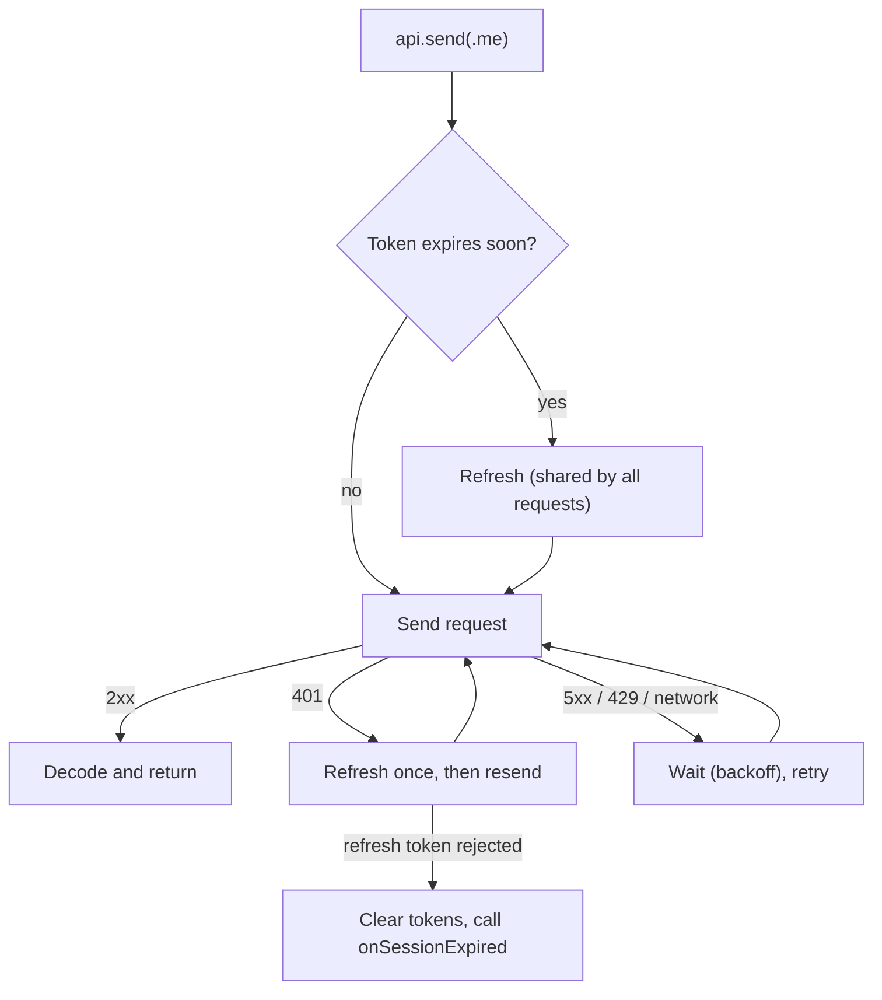

# NetworkLayer

A small iOS network layer: **URLSession + async/await, no dependencies.**

- Attaches the access token.
- Refreshes it (early, or on 401). Only one refresh runs at a time.
- Retries failures that are safe to retry, with backoff.
- Decodes JSON into your types.

## How a request flows



## Files

| File | Job |
|---|---|
| `APIClient.swift` | Sends requests. Runs the auth and retry loop. |
| `Core/Endpoint.swift` | Describes one call: path, method, body, response type. |
| `Auth/AuthManager.swift` | Owns tokens. Runs one refresh at a time. |
| `Auth/TokenRefresher.swift` | You implement this: calls your token endpoint. |
| `Auth/TokenStore.swift` | Keychain store and in-memory store. |
| `Retry/RetryPolicy.swift` | When to retry and how long to wait. |
| `Core/HTTPTransport.swift` | Wraps URLSession. Swap it for a fake in tests. |

## Add to your app

Xcode → **File → Add Package Dependencies… → Add Local…** → choose this folder.

## Setup

**1. Implement the refresher** (calls your auth server):

```swift
import NetworkLayer

struct TokenResponse: Decodable, Sendable {
    let accessToken: String
    let refreshToken: String
    let expiresIn: TimeInterval
}

struct OAuthRefresher: TokenRefresher {
    /// A client without auth, so refreshing can't trigger another refresh.
    let client: APIClient

    func refresh(using refreshToken: String) async throws -> AuthTokens {
        let response = try await client.send(Endpoint<TokenResponse>(
            method: .post,
            path: "/oauth/token",
            body: ["grant_type": "refresh_token", "refresh_token": refreshToken],
            requiresAuth: false
        ))
        return AuthTokens(
            accessToken: response.accessToken,
            refreshToken: response.refreshToken,
            expiresAt: Date().addingTimeInterval(response.expiresIn)
        )
    }
}
```

**2. Wire it once** (app start or your DI container):

```swift
let baseURL = URL(string: "https://api.example.com")!

let decoder = JSONDecoder()
decoder.keyDecodingStrategy = .convertFromSnakeCase

let auth = AuthManager(
    store: KeychainTokenStore(),
    refresher: OAuthRefresher(client: APIClient(baseURL: baseURL, decoder: decoder)),
    onSessionExpired: { await MainActor.run { /* show login */ } }
)
let api = APIClient(baseURL: baseURL, auth: auth, decoder: decoder)
```

**3. Define endpoints:**

```swift
extension Endpoint where Response == User {
    static var me: Self { Endpoint(path: "/me") }
    static func update(name: String) -> Self {
        Endpoint(method: .patch, path: "/me", body: ["name": name])
    }
}

extension Endpoint where Response == EmptyResponse {
    static func deletePost(id: Int) -> Self {
        Endpoint(method: .delete, path: "/posts/\(id)")
    }
}
```

**4. Use it:**

```swift
try await auth.signIn(with: tokensFromLogin)

let user = try await api.send(.me)

try await auth.signOut()
```

## Errors you should handle

| Error | Meaning | Do |
|---|---|---|
| `.sessionExpired` | Refresh token rejected. Tokens cleared. | Show login. |
| `.notAuthenticated` | No tokens. | Show login. |
| `.unauthorized` | Still 401 after refresh. | Permission problem. |
| `.httpStatus(code, data)` | Other non-2xx. | Read `data` for the server error. |
| `.transport(URLError)` | Offline or timeout, after retries. | Show "no connection". |

## Rules worth knowing

- **One refresh at a time.** 10 requests that get 401 together cause 1 refresh.
- **Refresh errors:** 400/401/403 from the token endpoint ends the session. Offline or 5xx keeps it.
- **Retry:** up to 3 attempts. Waits ~0.5s, then ~1s.
- **Safe by default:** `POST`/`PATCH` are not retried on 5xx or timeout (the server may have done the work). They are retried if the request never left the device (no connection, DNS).
- **`Retry-After`** is respected, up to 10s. Longer means give up.
- **Per endpoint:** set `retryPolicy: .never` or a custom `RetryPolicy`.

## Tests

```sh
swift test
```

22 tests cover refresh, single-flight refresh, sign-out during refresh, and the retry rules.
